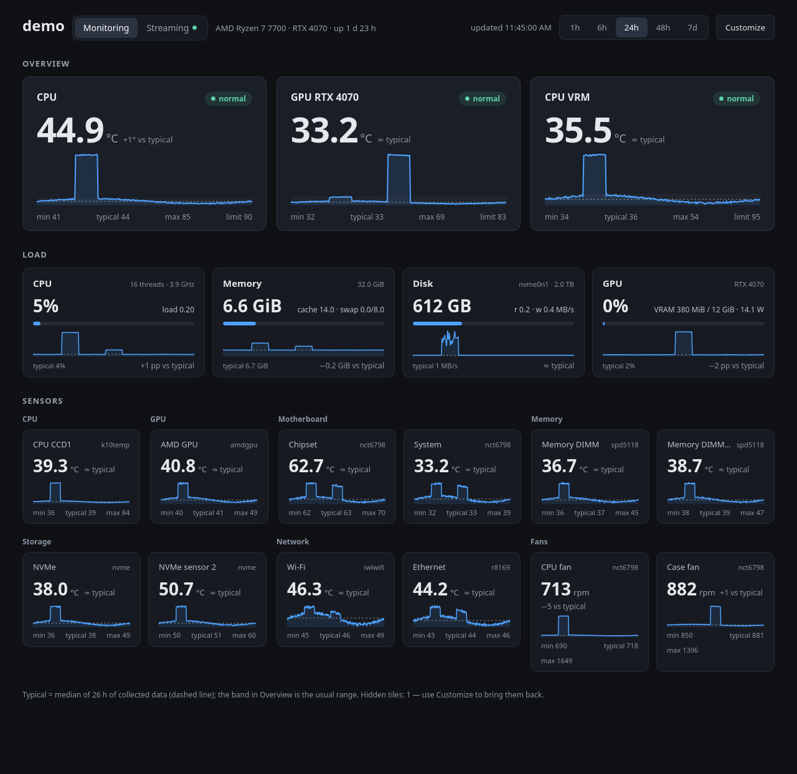
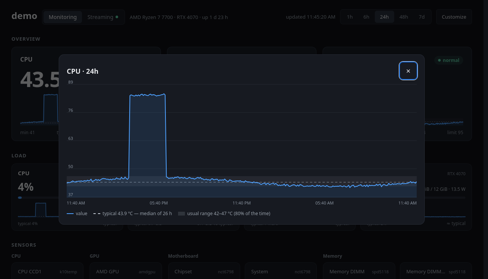
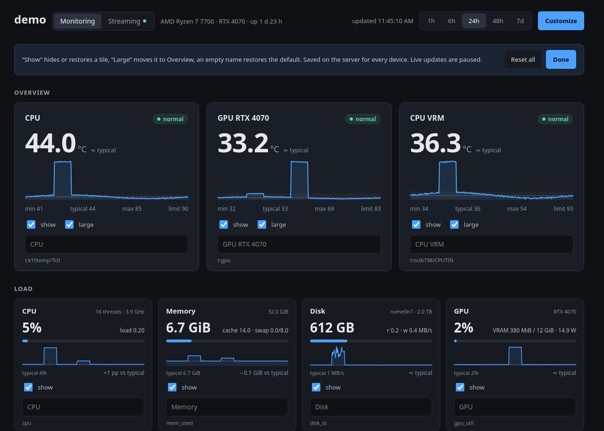
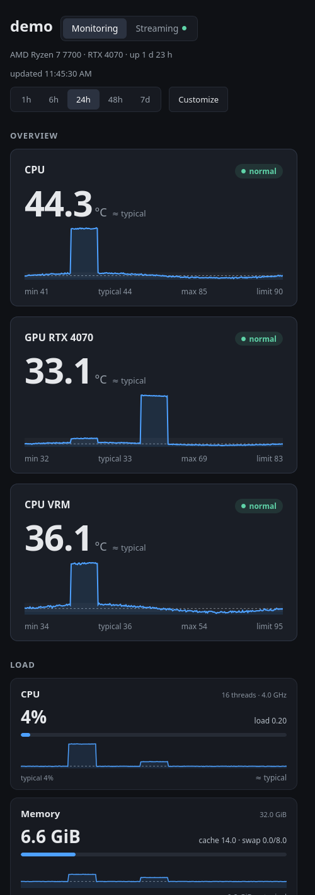
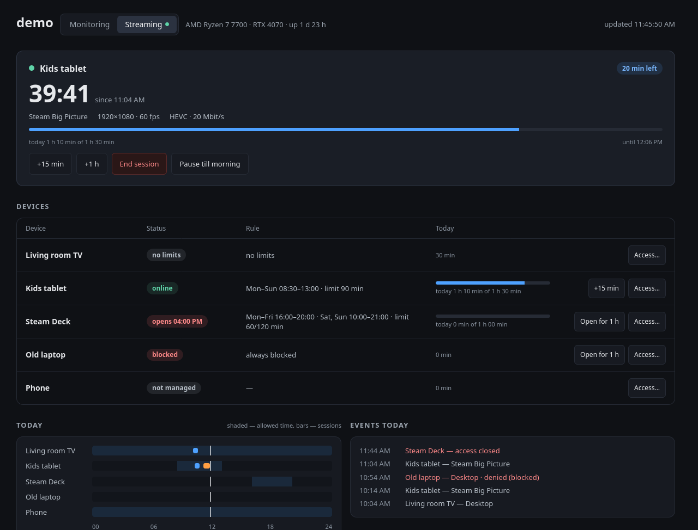
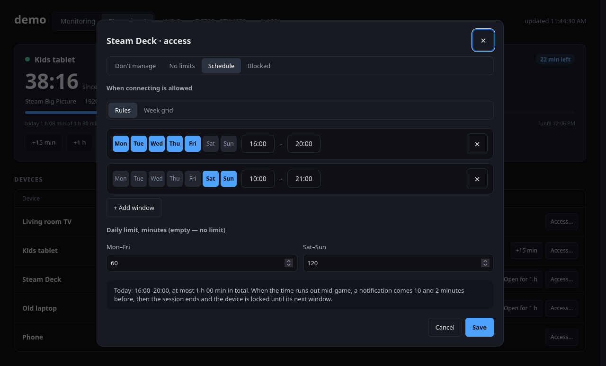
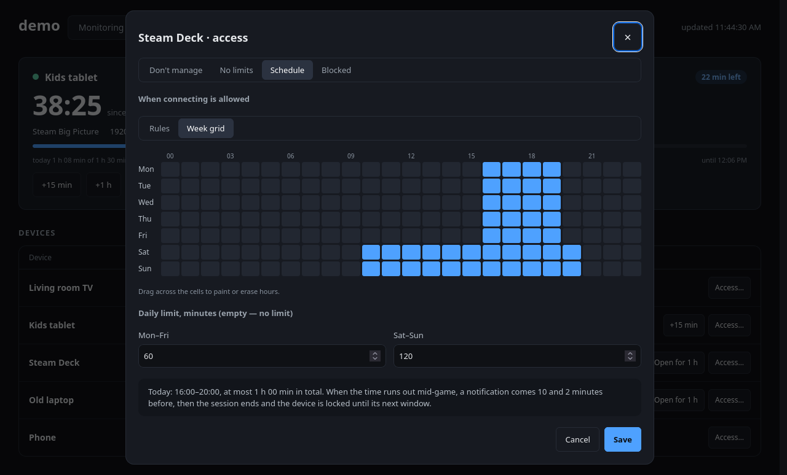
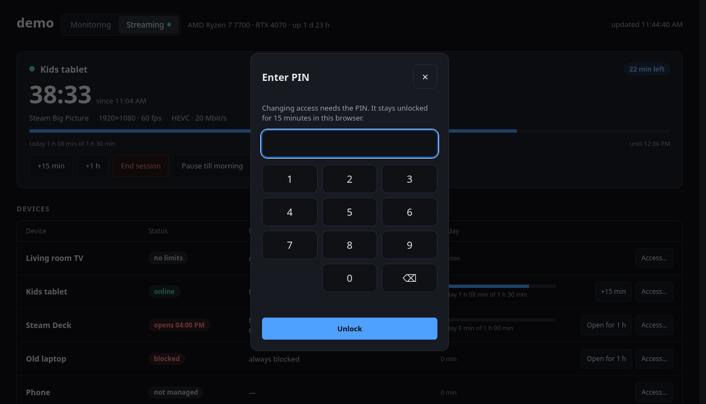

# hwdash

A tiny self-hosted dashboard for a Linux machine: every temperature sensor the
kernel exposes, fans, CPU, memory, disk and GPU — live values plus history up to
a week, with a per-sensor "typical" baseline so you can see at a glance what is
unusual.

Python standard library only, no build step, no database server.
About 35 MB of RAM and well under 1 % of one CPU core.

[Русская версия](README.ru.md)



## Features

- **All sensors, discovered automatically** from `/sys/class/hwmon`: CPU
  (`k10temp`, `zenpower`, `coretemp`), AMD GPU, NVMe/SATA drives, DIMMs, Wi-Fi
  and Ethernet chips, motherboard Super I/O chips, fans. NVIDIA GPUs through
  `nvidia-smi`, AMD GPU load through sysfs.
- **Focus on what matters**: the CPU and GPU (or any tiles you choose) are shown
  large at the top with a clear *normal / warm / hot* status; everything else is
  grouped by component in standard-size tiles.
- **Baselines**: for each metric hwdash keeps the median and the usual range
  (10th–90th percentile) of all collected data. Tiles show a dashed "typical"
  line and how far the current value is from it.
- **History**: 1 h / 6 h / 24 h / 48 h / 7 d; click any tile for a large chart
  with a hover tooltip.
- **Customize in the browser**: hide tiles, move them to the top, rename them.
  Settings are stored on the server, so every device sees the same layout.
- **Moonlight / Sunshine** (optional): live streaming sessions and per-device
  access schedules with daily limits — see [below](#moonlight--sunshine-sessions-and-access-schedules).
- **Network map** (optional): a **Network** tab with your VPN nodes and links. Node colour is
  a ping from this machine; link colour can come from the tunnel state on a Keenetic/Netcraze
  router — see the `[topology]` section of `config.example.toml`.
- English and Russian UI (by browser language, or `?lang=en|ru`).
- Works on a phone.

| Click a tile for details | Customize mode |
|---|---|
|  |  |

<p align="center"></p>

*Screenshots are taken in demo mode with made-up data.*

## Quick start

Requirements: Linux, Python 3.11+. Optional: `nvidia-smi` for NVIDIA GPUs.

```sh
git clone https://github.com/skazimax/hwdash.git
cd hwdash
python3 hwdash.py --demo      # made-up data, nothing is saved
python3 hwdash.py             # your machine
```

Open `http://<host>:8090`.

## Run as a service

```sh
./install.sh                  # systemd user service, starts now and on boot
./install.sh --uninstall
```

The service runs as your user from the cloned directory; `git pull` and
`systemctl --user restart hwdash` update it. To keep it running when nobody is
logged in, enable lingering once: `sudo loginctl enable-linger $USER`.

## Security

hwdash has **no authentication**. It only reads sensors and writes its own
files (`PUT /api/config` accepts nothing but validated tile settings), but it
does show hardware details and lets anyone who can reach it change the layout.
With `[topology]` enabled (off by default), anyone who can open the page also sees the node
names and addresses you configured. Router logins are never sent to the page, but they are kept
in a local file, and hwdash talks to the routers over the `api` address you set: with `http://`
the traffic is not encrypted, although the password itself is only sent hashed with a one-time challenge.
Prefer a router account with the fewest rights that still allows reading.

Keep it on a trusted network:

- listen on localhost only (`bind = "127.0.0.1"`) and use an SSH tunnel:
  `ssh -L 8090:localhost:8090 host`, or
- allow the port only from your LAN, e.g. `sudo ufw allow from 192.168.1.0/24 to any port 8090 proto tcp`.

Do not expose it to the internet.

## Configuration

Everything works without a config file. To change the port, retention or
sensor names, copy [`config.example.toml`](config.example.toml) to
`~/.config/hwdash/config.toml` (or pass `--config path`).

```toml
[server]
bind = "0.0.0.0"
port = 8090
retention_hours = 168

[sensors."t:nct6687/Thermistor 15"]
title = "CPU VRM"
warn = 95          # °C: orange from 90 % of it, red at it
focus = true       # large tile at the top
```

Each tile shows its sensor id in Customize mode — that is the key for
`[sensors."…"]`. Fields: `title`, `group`, `warn`, `focus`, `hidden`. Changes
made in the browser take precedence.

### Motherboard sensors and fans

Chassis, VRM, chipset temperatures and fan speeds come from the motherboard's
Super I/O chip, whose driver is often not loaded by default. Run
`sudo sensors-detect` (package `lm-sensors`) or load the module for your chip
(`nct6775`, `nct6683`, `it87`, …), then restart hwdash.

These drivers report channel names such as `Thermistor 0` or `AUXTIN1`, not the
place on the board. To find out which is which, put load on the CPU (or GPU)
for a minute and watch which values rise: the VRM follows CPU power, the socket
sensor follows slowly, the chipset barely moves. Then name them in the config
or in the browser.

## Moonlight / Sunshine: sessions and access schedules

If the machine streams games with [Sunshine](https://github.com/LizardByte/Sunshine)
(2025.x or newer), hwdash can add a **Streaming** tab: who is connected and what
is running, how long each paired device has streamed today, and when each device
is allowed to connect — a parental control for Moonlight clients.



| Rules and a daily limit | …or paint the week | Changes need a PIN |
|---|---|---|
|  |  |  |

Per device: **don't manage** (default — hwdash never touches it), **no limits**,
**schedule** (weekly windows plus a daily limit for weekdays and weekends) or
**blocked**. Quick actions: +15 min / +1 h, open for an hour, end the session,
pause until the morning.

How it is enforced:

- hwdash switches paired devices on and off with Sunshine's own *enabled* flag
  (`/api/clients/update`). Sunshine checks it on every request, so a closed
  device cannot start or resume a stream.
- A launch gate in Sunshine's `global_prep_cmd` records which device launched
  what (`SUNSHINE_CLIENT_NAME`) and refuses a launch outside the allowed time.
  It reads the same policy file, so it works even if hwdash is not running;
  errors inside the gate let the launch through rather than lock everyone out.
- When the time runs out mid-session: an on-screen notification 10 and 2
  minutes before (sent with `notify-send` on the host, so it shows in the stream
  on the desktop; a fullscreen game may hide it), then the stream ends and the
  device is switched off. The game keeps running for
  `game_close_grace_minutes` (5 by default): add time on the Streaming tab and
  the device can reconnect to the same game. Otherwise the game is closed
  (SIGTERM, then SIGKILL 15 s later), and unsaved progress is lost.
- Streaming time is the time between `CLIENT CONNECTED` and `CLIENT DISCONNECTED`
  in `sunshine.log`, credited to the device that launched the app.

Setup:

1. Save the Sunshine Web UI login for hwdash: `printf 'user:password' > ~/.config/hwdash/sunshine.cred && chmod 600 ~/.config/hwdash/sunshine.cred`
2. Enable the module in `~/.config/hwdash/config.toml`:
   ```toml
   [sunshine]
   enabled = true
   ```
3. Add the launch gate to `~/.config/sunshine/sunshine.conf` and restart Sunshine:
   ```
   global_prep_cmd = [{"do":"/usr/bin/python3 /path/to/hwdash/hwdash.py gate-start","undo":"/usr/bin/python3 /path/to/hwdash/hwdash.py gate-end","elevated":false}]
   ```
4. Set the PIN for changes: `python3 hwdash.py set-pin`, then `systemctl --user restart hwdash`.

Limitations:

- Moonlight's *Disconnect* (unlike *Quit*) leaves the app running, and a later
  reconnect resumes it without running prep commands, so hwdash cannot tell who
  resumed. Time is credited to whoever launched it; to keep that honest, a
  managed device's app is closed `close_after_disconnect_minutes` after it
  disconnects.
- The PIN travels over plain HTTP; it guards against someone at home changing
  the rules, not against a network attacker. After 5 wrong PINs the next try
  waits 30 s, then twice as long each time.

## How it works

- A collector thread samples every `step` seconds (default 10) and stores one
  JSON row per sample in SQLite (WAL); rows older than `retention_hours` are
  pruned hourly. A week at 10 s with ~30 metrics is about 80 MB.
- History responses are averaged into at most 288 points per series; min/max
  come from raw samples.
- Baselines use all stored data (thinned to 20 000 rows) and are recomputed
  every 10 minutes.
- The UI is a single static HTML file with inline CSS/JS and hand-drawn SVG
  charts — no frameworks, no CDN.

### API

| Endpoint | Description |
|---|---|
| `GET /api/now` | Current values, sensor metadata, host info |
| `GET /api/history?range=24h` | `1h`, `6h`, `24h`, `48h`, `7d`: bucketed series, min/max, baselines |
| `GET /api/config` | Tile settings made in the browser |
| `PUT /api/config` | Save tile settings: `{"hidden": {}, "focus": {}, "names": {}}` |
| `GET /api/stream` | Streaming tab: session, devices with rules and today's usage, events (`[sunshine]` only) |
| `POST /api/stream/login` | `{"pin"}` → `{"token"}`; send it as `X-Hwdash-Token` with the calls below |
| `PUT /api/stream/policy` | `{"uuid", "policy": {"mode", "days", "limit_weekday", "limit_weekend"}}` |
| `POST /api/stream/action` | `{"uuid", "action": "extend"\|"pause_today"\|"pause_morning"\|"end"\|"clear"\|"close_game", "minutes"}` |

## Development

```sh
python3 -m unittest discover -s tests
python3 hwdash.py --demo --port 8091
```

## License

[MIT](LICENSE)
