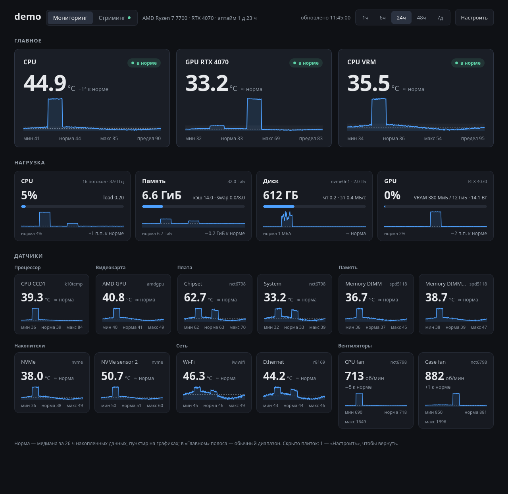
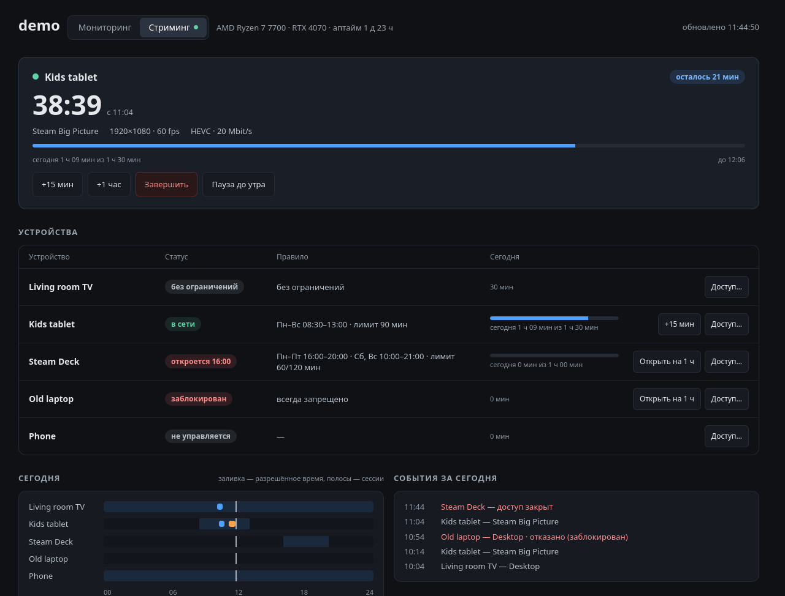

# hwdash

Маленький дашборд для Linux-машины: все датчики температуры, которые видит
ядро, вентиляторы, CPU, память, диск и GPU — текущие значения и история до
недели, а для каждого датчика — «норма», чтобы сразу видеть, что необычно.

Только стандартная библиотека Python: без сборки и без сервера БД. Около 35 МБ памяти и заметно меньше 1 % одного ядра.

[English version](README.md)



## Возможности

- **Все датчики находятся автоматически** в `/sys/class/hwmon`: CPU
  (`k10temp`, `zenpower`, `coretemp`), видеокарты AMD, NVMe/SATA, модули памяти,
  Wi-Fi и Ethernet, Super I/O материнской платы, вентиляторы. NVIDIA — через
  `nvidia-smi`, загрузка AMD GPU — через sysfs.
- **Главное — крупно**: CPU и GPU (или любые выбранные плитки) наверху со
  статусом *в норме / тепло / горячо*; остальное — стандартными плитками по
  группам.
- **Норма**: для каждой метрики — медиана и обычный диапазон (10–90 перцентиль)
  по всем накопленным данным. На плитках — пунктир нормы и отклонение от неё.
- **История**: 1 ч / 6 ч / 24 ч / 48 ч / 7 д; по клику на плитку — крупный
  график с подсказкой.
- **Настройка в браузере**: скрыть плитку, вынести наверх, переименовать.
  Хранится на сервере — одинаково на всех устройствах.
- **Карта сети** (по желанию): вкладка **Сеть** с узлами и линками VPN. Цвет узла — пинг с этого компьютера, цвет линка может браться из состояния туннеля на роутере Keenetic/Netcraze. Настройка: раздел `[topology]` в `config.example.toml`.
- **Moonlight / Sunshine** (по желанию): активные сессии стрима и расписание
  доступа для каждого устройства с дневным лимитом — см. [ниже](#moonlight--sunshine-сессии-и-родительский-контроль).
- Интерфейс на русском и английском (по языку браузера или `?lang=ru|en`).
- Работает на телефоне.

Ещё скриншоты — в [README.md](README.md). Скриншоты сделаны в демо-режиме на
выдуманных данных.

## Быстрый старт

Нужно: Linux, Python 3.11+. Для NVIDIA — `nvidia-smi`.

```sh
git clone https://github.com/skazimax/hwdash.git
cd hwdash
python3 hwdash.py --demo      # выдуманные данные, ничего не сохраняется
python3 hwdash.py             # ваша машина
```

Откройте `http://<хост>:8090`.

## Как сервис

```sh
./install.sh                  # systemd user-сервис, стартует сейчас и при загрузке
./install.sh --uninstall
```

Сервис работает от вашего пользователя из папки клона; обновление — `git pull`
и `systemctl --user restart hwdash`. Чтобы он работал без входа в систему:
`sudo loginctl enable-linger $USER`.

## Безопасность

**Авторизации нет.** hwdash только читает датчики и пишет свои файлы
(`PUT /api/config` принимает только проверенные настройки плиток), но
показывает сведения о железе и даёт любому, кто до него достучится, менять
раскладку.

Если включён `[topology]` (по умолчанию выключен), любой, кто может открыть страницу, видит названия и адреса настроенных узлов. Логины роутеров на страницу не передаются, но хранятся в локальном файле, а hwdash обращается к роутерам по указанному адресу `api`: при `http://` трафик не шифруется, хотя сам пароль передаётся только в виде хеша с одноразовым запросом. Лучше использовать учётную запись роутера с минимальными правами, достаточными для чтения.

Держите его в доверенной сети:

- слушать только localhost (`bind = "127.0.0.1"`) и ходить через SSH-туннель:
  `ssh -L 8090:localhost:8090 host`, или
- открыть порт только для LAN, например
  `sudo ufw allow from 192.168.1.0/24 to any port 8090 proto tcp`.

Не публикуйте его в интернет.

## Настройка

Всё работает без конфига. Чтобы поменять порт, срок хранения или названия
датчиков, скопируйте [`config.example.toml`](config.example.toml) в
`~/.config/hwdash/config.toml` (или укажите `--config путь`).

```toml
[server]
port = 8090
retention_hours = 168

[sensors."t:nct6687/Thermistor 15"]
title = "VRM процессора"
warn = 95          # °C: оранжевый от 90 % порога, красный — от порога
focus = true       # крупная плитка наверху
```

В режиме «Настроить» на каждой плитке виден её id — это ключ для
`[sensors."…"]`. Поля: `title`, `group`, `warn`, `focus`, `hidden`.
Настройки из браузера имеют приоритет.

### Датчики платы и вентиляторы

Температуры VRM, чипсета, корпуса и обороты вентиляторов отдаёт Super I/O
материнской платы, и его драйвер часто не загружен. Запустите
`sudo sensors-detect` (пакет `lm-sensors`) или загрузите модуль своего чипа
(`nct6775`, `nct6683`, `it87`, …) и перезапустите hwdash.

Драйверы называют каналы вроде `Thermistor 0` или `AUXTIN1`, а не место на
плате. Чтобы понять, что есть что, дайте минуту нагрузки на CPU (или GPU) и
посмотрите, что растёт: VRM следует за мощностью CPU, датчик сокета растёт
медленно, чипсет почти не меняется. Затем подпишите их в конфиге или в браузере.

## Moonlight / Sunshine: сессии и родительский контроль

Если машина стримит игры через [Sunshine](https://github.com/LizardByte/Sunshine)
(2025.x и новее), hwdash добавляет вкладку **Стриминг**: кто подключён и что
запущено, сколько каждое устройство стримило сегодня и когда ему можно
подключаться.



Для каждого устройства: **не управлять** (по умолчанию — hwdash его не трогает),
**без ограничений**, **по расписанию** (окна по дням недели и дневной лимит для
будней и выходных) или **запрещено**. Быстрые действия: +15 мин / +1 час,
открыть на час, завершить сессию, пауза до утра. Окна задаются правилами или
закрашиванием сетки недели; менять что-либо можно только с PIN.

Как это работает:

- hwdash включает и выключает устройства встроенным флагом Sunshine *enabled*
  (`/api/clients/update`). Sunshine проверяет его на каждом запросе, так что
  закрытое устройство не начнёт и не продолжит стрим.
- Скрипт в `global_prep_cmd` Sunshine записывает, какое устройство что запустило
  (`SUNSHINE_CLIENT_NAME`), и отказывает в запуске вне разрешённого времени.
  Он читает тот же файл правил и работает даже без hwdash; при собственной
  ошибке пропускает запуск, а не блокирует всех.
- Если время вышло во время игры — уведомление за 10 и 2 минуты (`notify-send`
  на хосте, видно в стриме рабочего стола; полноэкранная игра может его
  скрыть), затем стрим завершается и устройство выключается. Игра работает ещё
  `game_close_grace_minutes` (по умолчанию 5): если добавить время на вкладке
  «Стриминг», устройство подключится к той же игре. Иначе игра закрывается
  (SIGTERM, через 15 с SIGKILL), несохранённый прогресс теряется.
- Время стрима — промежутки между `CLIENT CONNECTED` и `CLIENT DISCONNECTED` в
  `sunshine.log`, засчитываются устройству, которое запустило приложение.

Подключение:

1. Логин Web UI Sunshine для hwdash: `printf 'user:password' > ~/.config/hwdash/sunshine.cred && chmod 600 ~/.config/hwdash/sunshine.cred`
2. В `~/.config/hwdash/config.toml`:
   ```toml
   [sunshine]
   enabled = true
   lang = "ru"
   ```
3. В `~/.config/sunshine/sunshine.conf`, затем перезапустить Sunshine:
   ```
   global_prep_cmd = [{"do":"/usr/bin/python3 /path/to/hwdash/hwdash.py gate-start","undo":"/usr/bin/python3 /path/to/hwdash/hwdash.py gate-end","elevated":false}]
   ```
4. PIN для изменений: `python3 hwdash.py set-pin`, затем `systemctl --user restart hwdash`.

Ограничения:

- «Disconnect» в Moonlight (в отличие от «Quit») оставляет приложение
  запущенным, а повторное подключение продолжает его без prep-команд — кто
  подключился, hwdash не знает. Время засчитывается тому, кто запустил; чтобы
  это было честно, приложение управляемого устройства закрывается через
  `close_after_disconnect_minutes` после отключения.
- PIN передаётся по обычному HTTP: это защита от того, кто дома захочет
  поменять правила, а не от атаки в сети. После 5 неверных попыток следующая —
  через 30 с, дальше вдвое дольше.

## Как устроено

- Поток-сборщик раз в `step` секунд (по умолчанию 10) пишет одну JSON-строку в
  SQLite (WAL); строки старше `retention_hours` удаляются раз в час. Неделя
  при шаге 10 с и ~30 метриках — около 80 МБ.
- История усредняется до ≤ 288 точек на серию; мин/макс — по сырым данным.
- Норма считается по всем данным (прорежено до 20 000 строк), раз в 10 минут.
- Интерфейс — один статический HTML с встроенными CSS/JS и SVG-графиками,
  без фреймворков и CDN.

API описан в [README.md](README.md#api).

## Разработка

```sh
python3 -m unittest discover -s tests
python3 hwdash.py --demo --port 8091
```

## Лицензия

[MIT](LICENSE)
